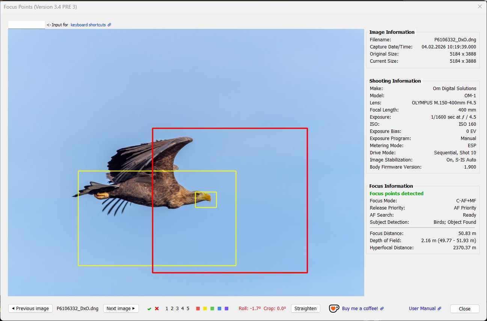
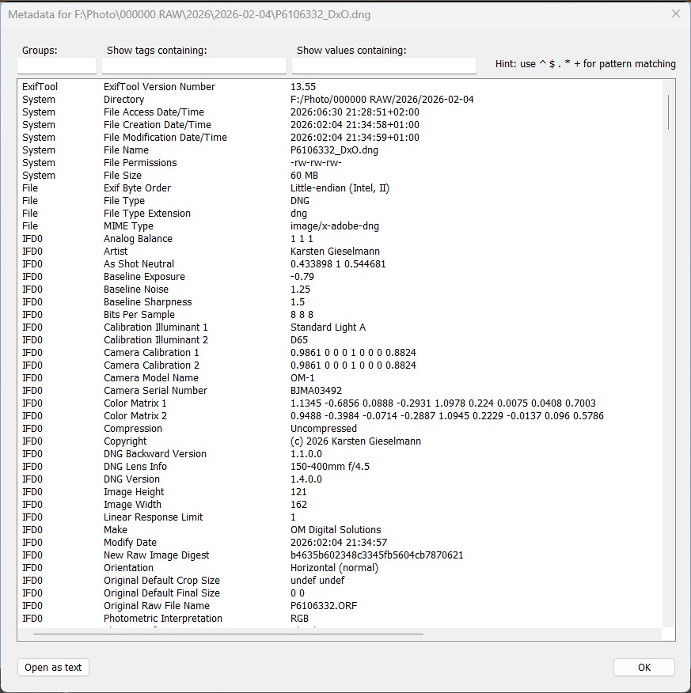
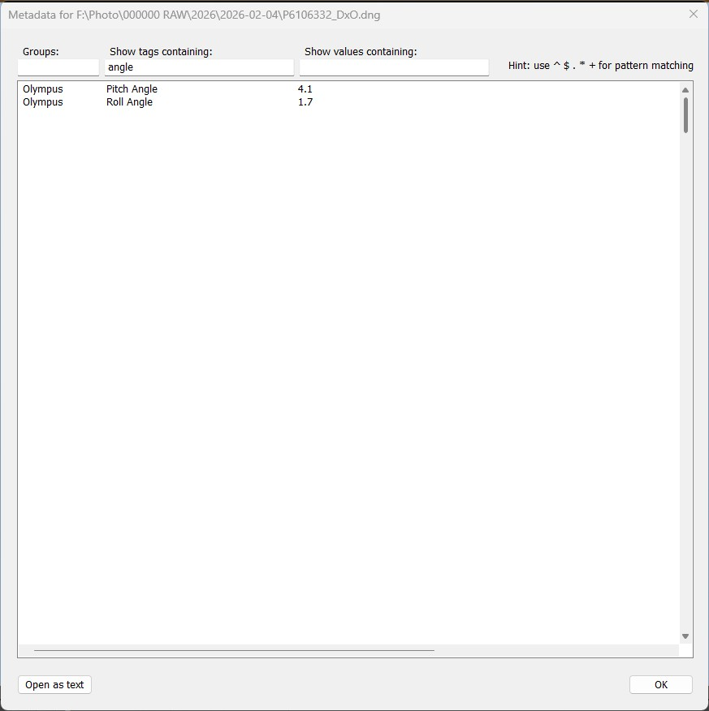
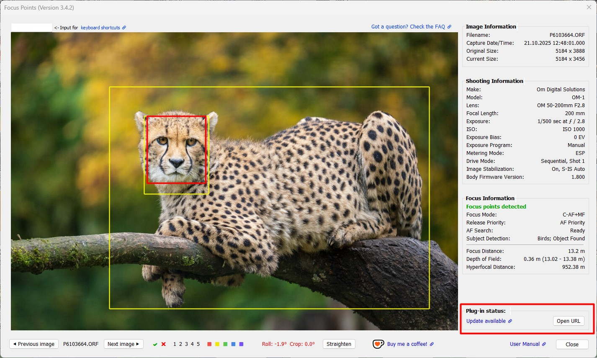
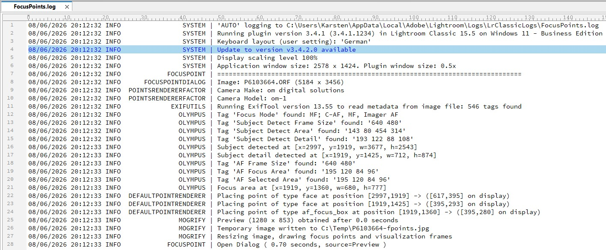

## ⚠️ Important update for users of V3.4 and V4 PRE 1  [CRITICAL: Update check fails to detect available updates in V3.4 and V4 PRE 1](https://github.com/FocusPointsLrC/Focus-Points/issues/405)

 

# User Manual

## Content

### [Scope and Limitations](#1-scope-and-limitations)

### [Overview and Basic Operation](#2-overview-and-basic-operation)

*  [Installation](#21-installation)
*  [Focus Point Viewer](#22-focus-point-viewer) 
   - [User Interface](#user-interface), [User Messages](#user-messages), [Plugin Status](#plugin-status), [Keyboard Shortcuts](#keyboard-shortcuts) 
*  [Metadata Viewer](#23-metadata-viewer)
*  [Straighten Images](#24-straighten-images)
   - [Operation](#operation), [Customization](#Customization), [Keyboard Shortcut](#keyboard-shortcut), [General Remarks](#general-remarks) 
*  [Configuration and Settings](#25-configuration-and-settings)
   - [Screen Scaling](#screen-scaling), [User Interface](#user-interface-settings), [Viewing Options](#viewing-options), [Logging](#logging), [Straightening Options](#straightening-options), [Update Check](#update-check)

### [Display of Focus Points](#3-display-of-focus-points)

* Camera-maker specific sections for:  [Canon](#32-canon), [Nikon](#31-nikon), [Sony](#33-sony), [Fuji](#34-fuji), [Olympus](#35-olympus), [OM System](#36-om-system),  [Panasonic](#37-panasonic), [Pentax](#38-pentax), [Ricoh](#39-ricoh), [Apple](#310-apple)

### [Status Messages and Warnings](Troubleshooting_FAQ.md#status-messages-and-warnings)

### [Special Topics](#4-special-topics)

* [How to use a keyboard shortcut to run the plugin](#how-to-use-a-keyboard-shortcut-to-run-the-plugin)
* [How to reduce long wait times when opening the plugin window on Windows](#how-to-reduce-long-wait-times-when-opening-the-plugin-window-on-windows)

### [Compatibility](Compatibility.md)

* [Cameras that support display of autofocus points](Compatibility.md#cameras-that-support-display-of-autofocus-points)
* [Cameras that support straightening images](Compatibility.md#cameras-that-support-straightening-images)
* [Features not supported in earlier versions of Lightroom](Compatibility.md#features-not-supported-in-earlier-versions-of-lightroom)

 

# 1. Scope and Limitations

A plugin for Lightroom Classic1 on Windows and macOS: 
- Show which focus point was active when the picture was taken 2
- Display user-selected autofocus points/area 3,4
- Visualize faces and subjects detected by the camera 3,5
- Tagging (flagging, rating and coloring) of photos within the plugin UI 7
- Display and search (EXIF) metadata of the selected image 
- Straightening images by applying compensation for camera roll angle3,6,7

1 LR5.7 and LR6 perpetual licenses and LrC subscriptions. 
2 For Canon, Nikon, Sony, Fuji, Olympus/OM, Panasonic, Pentax, Ricoh, Apple. 
&nbsp;&nbsp;&nbsp;Check the [list of supported cameras](Compatibility.md#cameras-that-support-display-of-autofocus-points) to see if your camera is supported. 
3 Depending on the presence of metadata.  
4 Currently supported for Pentax and OM System.  
5 Currently supported for Fuji, OM System (subjects, faces) and Sony, Olympus, Pentax (faces).  
6 Currently supported for Canon, Nikon, Fuji, Olympus/OM, Panasonic, Pentax, Ricoh. 
7 Not for LR5. 

To understand how to use this plugin and how to interpret the results, **it is recommended that you read chapters 1, 2 and the part of chapter 3 that applies to your camera**.
 
 

### Principle of operation

The plugin uses [ExifTool](https://exiftool.org/) to retrieve metadata from image files. Autofocus related information is extracted from the metadata and processed to detect and visualize focus points, faces and subjects. For this to work, the plugin needs an image file that contains camera manufacturer specific metadata information (_makernotes_), written by the camera to each JPG or RAW file. The plugin will not be able to show focus points for image files that do not contain makernotes data.

<u>Note:</u> ExifTool is part of the plugin package and does not need to be installed separately.

As the plugin operates within Lightroom, it is important to note that Lightroom does not read the maker notes information when importing files. More precisely, this information is not visible or accessible in Lightroom, except in a few cases. 

When the plugin is run on a selected photo, it uses ExifTool to process the underlying image file. When Lightroom exports a photo as a JPEG or TIFF file to be edited in an external application, a new image file is created that lacks the maker notes data. Therefore, any image re-imported from that application will lack this essential information for the plugin to work.

**Examples of when focus points are not displayed:**
- Photo edited in Photoshop and returned as PSD or TIF
- Photo transferred as TIFF/JPG to a 3rd party editor (`Photo → Edit In`) and returned as TIF,  e.g. Topaz, NIK, Photomatix
- DNG files created by Lightroom's Photo Merge (HDR, Panorama)
- Photos exported to disk that have been re-imported in Lightroom
- Smart Preview but the original image file is not present 

For external applications launched from within Lightroom that use a RAW file as input (typically invoked from the 'Plug-in Extras' menu), the plugin may work on the file that is imported into Lightroom if the application leaves the original file's makernotes intact. This is because, in this case, Lightroom only passes on the name of the image file, not the file itself. 

**Examples, for which focus point display may work on image files created based on original RAW files:**

- DNG files converted from RAW by Adobe's DNG Converter (standalone app, or inside Lightroom)
- DNG files created by DxO PhotoLab, Luminar Neo, Topaz Photo AI
- DNG files created by Lightroom's Enhance feature, e.g. AI Denoise (prior to LrC 14.4)

Note that this may depend on the specific camera make/model.  
E.g. for Fuji DNG files the plugin will not be able to display focus points.

**Cases where the Focus Points plugin may not be able to display meaningful information:**

* <u>Focus and Pan, Recompose</u>: The shot was taken by focusing on the main subject and then panning the camera to get the desired composition. The focus point recorded by the camera does not `move` with the focused subject during recomposition, but maintains its original position.
* <u>Back button Focus</u>: This is similar to Recompose because the underlying principle is the same. In addition, the camera may not even record a focus point (depending on the make/model).

 

# 2. Overview and Basic Operation
This section will explain how to install, configure, and use the plugin.

## 2.1 Installation

### 2.1.2 Compact Instructions

1. Download the plugin Focus-Points-[Version].zip

2. If you’re **upgrading from a previous version** of Focus Points, 
   - exit Lightroom
   - delete the existing focuspoints.lrplugin folder 
   - replace it with the new one extracted from the downloaded .zip
   - restart Lightroom and you’re done.

3. If this is a **new installation**,
   - extract the folder focuspoints.lrplugin from the downloaded .zip
   - move it to a location of your choice.

4. In Lightroom, do File > Plug-in Manager.

5. Click Add, browse and select the focuspoints.lrplugin folder, and click Select Folder (Windows) or Add Plug-in (Mac OS).

### 2.1.3 Detailed Instructions
1. Download the [latest release](https://github.com/FocusPointsLrC/Focus-Points/releases/latest) of the plugin package. 
A file named `Focus-Points-[plugin_version].zip` will be downloaded to your computer.

2. Unzip the downloaded file. Inside the extracted content locate the plugin folder `focuspoints.lrplugin`. 
_MAC users_: According to your macOS preferences the zip file will be automatically unzipped.

3. Find the folder where you keep your Lightroom plugins.  If you don't know where this is, open Lightroom, go to `File → Plug-in Manager` and click `Add`. This will open a "Select Folder" dialog in Lightroom's default folder for plugins. 

4. To **update an existing installation**, first remove the folder containing the version of the plugin you want to update. You can delete the folder or rename it, for example, `to focuspoints.lrplugin.303` (for version 3.03). This allows you to easily revert to the previous version if the update causes issues. 
<u>Note</u>: It is necessary to remove the plugin folder at OS level because deleting a plugin in Lightroom's Plug-in Manager only removes it from Lightroom's list of known plugins. The plugin folder and its contents on disk remain as they are. 
Important: Copying the downloaded files over those in the existing folder is not recommended!

5. Move the downloaded plugin folder `focuspoints.lrplugin` to the folder where you keep your Lightroom plugins.  
_MAC users_: if you have to navigate into the content of the `adobe lightroom classic.app`, use the control-click and choose  `show package content`.

6. Open Lightroom and go to `File → Plug-in Manager`. 
**New installation**: 
_Windows_: Click the `Add` button and select the plugin. 
_MAC_: In case of you'd copied the plugin to the default LR-plugin location, the new plugin is already listed - activate it. Otherwise, click on the `Add` button and select the plugin. 
**Update installation**: 
Select the plug-in and click `Reload plug-in` (only applies if Lightroom is open during the installation of the update.)

Once the plugin has been installed, choose one or more photos and select:

Library module: 
`Library → Plug-in Extras → Show Focus Point`

Develop module: 
`File → Plug-in Extras → Show Focus Point`

See [How to use a keyboard shortcut to run the plugin](#how-to-use-a-keyboard-shortcut-to-run-the-plugin) to learn how to invoke the plugin using a hotkey.

If you have never used Lightroom plugins before and are looking for some basic information, a video tutorial would be a good place to start. For example, [Plugin Installation (5:16)](https://www.youtube.com/watch?app=desktop&v=dxB4eVcNPuU) or [How to Install & Remove Lightroom Plug-ins (11:30)](https://www.youtube.com/watch?v=DFFA8nKBsJw). 

 

## 2.2 Focus Point Viewer
Once the plugin is installed, you can run it with one or more photos selected:

Library module: 
`Library → Plug-in Extras → Focus Point`

Develop module: 
`File → Plug-in Extras → Focus Point`

### User Interface

The user interface is divided into three main areas. On the left is the Photo View (1), which shows visualized focus points and detected elements. On the right is the Info View (2+3), a side-by-side view of information that may be useful for evaluating the photo in terms of focus results. The controls for navigating,  flagging and straightening images and are located at the bottom of the window (4+5+6).

The Focus Point Viewer window cannot be resized dynamically. However, you can customize the size of the window using the [Size of plugin window](#size-of-plugin-window) setting. There are six options to choose from, ranging from 3XL to S. This setting corresponds to 90% (3XL) downto 40% (S), in increments of 10% of the size of the Lightroom application window and it refers to the dimensions of the photo view. 
The info view and the bottom row of user controls are not included in this percentage. The space allocated to these areas is in addition to the size setting.

Click on the following links for more detailed information:

1. [Photo View](#photo-view)
2. [Info View](#info-view)
3. [Plugin Status](#plugin-status)
4. [Navigation Controls](#navigation-controls)
5. [Flagging Controls](#flagging-controls)
6.  [Straightening Control](#straightening-control)
7. [Keyboard Shortcuts](#keyboard-shortcuts)
8. [Check the FAQ](#got-a-question-check-the-faq)
9. [Buy me a coffee](#buy-me-a-coffee)

### Photo View

The plugin uses colors to visualize autofocus points, detected faces, subjects and details. This means that the respective area is highlighted by a rectangular marker: 

This overview shows which elements are supported by the plugin, and the shapes and colors used to visualize them. On Windows, the rectangular marker is a solid frame. On macOS, the frame is indicated by corner symbols*.

|                                       MAC                                       |                                         WIN                                         |       Color       | Meaning                                                                               |
|:-------------------------------------------------------------------------------:|:-----------------------------------------------------------------------------------:|:-----------------:|---------------------------------------------------------------------------------------|
|        |        |  red1  | Active AF point. Focus area, dimensions reported by the camera                        |
|  |  | red1,2 | Active AF point. Focus location3, pixel coordinates reported by the camera |
|      |      |       white       | User-selected AF point                                                                |
|      |      |       gray        | Inactive AF point. Part of DSLR AF points but not used for the image3      |
|              |              |      yellow       | Face or subject detected by the camera in this area                                   |
|              |              |       black       | Part of the image that is used by the camera in 'crop mode'                           |

1 AF point color can be chosen from red, green, blue in [Viewing Options](#viewing-options). 
2 'Focus-pixel' shape and size can be chosen from different options (small box or medium/large with center dot) in [Viewing Options](#viewing-options). 
3 The meaning may vary depending on the camera manufacturer. See the camera-specific chapters for a detailed explanation.

\* Tech Note: Windows and macOS use different rendering implementations, so the display of focus points and other elements looks different on each operating system. On macOS, focus points and face/object detection and cropping frames are indicated only by the corners, while on Windows, all frames have solid lines. This is due to the fact that the Lightroom SDK methods for overlaying information (frame corners and center points) on an image work on macOS but not on Windows. On Windows, this is done by ImageMagick (mogrify), which draws rectangles with solid lines.

Availability of the same method(s) on both platforms (ideally chosen by the user) would be desirable, but this is challenging and requires significant effort.

### Info View

The text pane right to the photo view comprises three groups:
- Image Information
- Shooting Information
- Focus Information

Image information and Shooting information are largely taken from the Lightroom catalog, so this information is available for every photo. Depending on the availability of information in the makernotes, these two sections may be expanded to include various camera-specific information such as crop mode, drive mode, shot number, etc., which may be useful in the context of evaluating focus results.

Focus information is only available for photos for which the corresponding image file contains complete metadata. See [Scope and Limitations](#1-scope-and-limitations) for more detailed information.

Two buttons at the bottom of the window allow you to move forward and backward through a series of photos, if more than one was selected in Lightroom when the plugin was launched. In case the plugin was launched on a single photo, the buttons are inactive.

A link to the User Guide (this document) provides quick and easy access to the operating instructions.

The window can be closed by clicking `Exit` or pressing \<Enter> or \<Esc> or \<Space>.
 

#### Focus Distance, Depth of Field, Hyperfocal Distance

Most camera makers include subject or focus distance information in makernotes. Sony, Fuji and Pentax do not, so this section is not relevant to images taken with their cameras.

ExifTool uses the focus distance information to calculate the depth of field (DoF), which can be helpful in assessing whether the lens is stopped down enough to capture a subject "acceptably sharp", i.e. whether the desired portion of the subject is "in focus". ExifTool also calculates the hyperfocal distance, which can be helpful in determining if the autofocus is set at the correct distance for photos that should be sharp from front to back (e.g. landscapes).

Note that the accuracy of focus distance values is limited. Cameras are not designed to measure distances. The values given in the EXIF data are byproducts of the focusing process, derived from control information to move the lens to a certain distance. Such focus step counts can be approximated as a distance. The degree of inaccuracy, and therefore the usefulness of this data, depends on several aspects. Typically, focus distance values are less accurate at short focal lengths. Also, this information is likely to be inaccurate under extreme conditions (macro or infinity). Finally, the equipment also plays a role.

Technical note: ExifTool creates pseudo tags `DepthOfField` and `HyperfocalDistance` which can be seen in ExifTool output. For calculation of DoF it uses the standard circle of confusion parameter for the respective sensor. In this context, the term “sharpness” refers to the ability of the human eye to recognize and resolve details when an image is viewed at full size, i.e. not enlarged, also known as “pixel peeping”.

Example: DoF in this capture is only ~2 cm, so with the chosen aperture of f/1.8 the eyes will be outside the sharp zone if the shot is focused on the front whiskers.
 

### User Messages

The first line of text in the `Focus Information` section contains a message summarizing whether the plugin was successful in its task to detect and visualize focus points. This can be a success message (in green letters), a warning (orange) or an error message (red):

|  Type   | Message                                                                                                         |
|:-------:|-----------------------------------------------------------------------------------------------------------------|
| Success | Focus points detected                                                                                           |
| Warning | [No focus points recorded](./Troubleshooting_FAQ.md#no-focus-points-recorded)                                   |
| Warning | [Focus point recorded in manual focus mode](./Troubleshooting_FAQ.md#focus-point-recorded-in-manual-focus-mode) |
| Warning | [Manual focus, no AF points recorded](Troubleshooting_FAQ.md#manual-focus-no-AF-points-recorded)                |
|  Error  | [Focus info missing from file](Troubleshooting_FAQ.md#focus-info-missing-from-file)                             |
|  Error  | [Camera model not supported](Troubleshooting_FAQ.md#camera-model-not-supported)                                 |
|  Error  | [Camera maker not supported](Troubleshooting_FAQ.md#camera-maker-not-supported)                                 |
|  Error  | [No camera-specific metadata found](Troubleshooting_FAQ.md#no-camera-specific-metadata-found)                   |
|  Error  | [Severe error encountered](Troubleshooting_FAQ.md#severe-error-encountered)                                     |

Click on the message to learn what it means and how to deal with it in case of an error or warning.

You can also access this information from the plugin window by clicking the link icon 🔗 next to the message:

### Plugin Status

If errors or warnings were encountered while processing the autofocus metadata, a status message is displayed at the bottom of the text pane. To the right of this message, you can click the `Check log` button to open the logfile for more details. The logfile contains detailed information about the metadata processing, such as relevant tags found (or not found). 
See [Logging](#logging) how to set up and customize logging. 

For the image above, where focus info is said to be "missing from file", the logfile looks like this:

There are two warnings and one error:
The tag `CameraSettingsVersion` has not been found which means that this file does not contain a makernotes section with AF information (which is required for the plugin to work). The image file was not created in-camera but by an application. In this case, it is a JPG file exported from (and created! by) Lightroom.

### Navigation Controls

Use the `Next image` and `Previous image` buttons to scroll through the photos.

In Lightroom, if only one photo is selected in the filmstrip, `Next image` will advance to the next photo in the _filmstrip_, and `Previous image` will advance to the previous photo in the _filmstrip_. There is no wrap-around when the beginning or end of the film strip is reached.

To run the plugin on a specific series of photos, select those photos in Lightroom _before_ running the plugin. In this case, `Next image` will advance to the next photo in the selection, and `Previous image` will advance to the previous photo in the selection. A wrap-around occurs when the beginning or end of the film strip is reached.

<u>Note</u>: _Filmstrip_ navigation uses the 'LrSelection' namespace, which is only available in SDK version 6.0 and above. Therefore, this feature is not available on LR5.7.

### Flagging Controls

Users for whom focus point accuracy is critical when selecting shots now have the ability to flag, reject, rate or color images directly within the plugin. The user interface has been updated to include the relevant controls: 

 Windows

 macOS

Tagging can be performed using the same logic and [keyboard shortcuts](#keyboard-shortcuts) as in Lightroom. Pressing the Shift key during tagging moves the plugin to the next photo.

**Notes / Restrictions:**

- Although the plugin allows you to set the flag status, rating and color label of a photo, these settings are **not** reflected in the plugin's user interface. Any changes to the flag status, rating or color will be acknowledged immediately with a standard message in Lightroom, and these changes will be reflected in the filmstrip for the selected photo. **It is recommended that you adjust the sizes of the plugin window and Lightroom's filmstrip when using tagging, so that both are visible at the same time.**

- Use of `Shift` + `0`-`9` keyboard shortcuts require that the plugin is aware which international keyboard layout is currently used. This is necessary because the plugin cannot recognize key codes; it can only work with text input. See [Keyboard Shortcuts](#keyboard-shortcuts). 
The keyboard layout in use can be configured in the plugin preferences, under the `User Interface`' section, [Keyboard Layout](#keyboard-layout) setting.
  
- The LR SDK does not support clickable images, so all control elements must be text or text buttons. As the plugin UI displays all Unicode 'star symbol' characters as small, hardly recognizable stars, the rating controls are represented by numbers 1–5 instead.

- The display of tagging controls and related keyboard shortcut operation can be disabled in the plugin preferences, under section `User Interface`.

- Note: Tagging features use the 'LrSelection' namespace, which is only available in SDK version 6.0 and above. Therefore, these features is not available on LR5.7 (which is still in use by a few plugin users!).

### Straightening Control

V3.4 enables you to level the image currently displayed in the Focus Point window. You have visual control of the result and the option to undo. This is the interactive version of the ['Straightening Images'](#24-straighten-images) batch process. The same options and restrictions apply.

**How the Straighten Control Works**

1. Images supported by this feature have two relevant angle values associated with them:  
   - Roll Angle – the horizontal tilt of the camera at the time the image was captured.
   - Crop Angle – the rotation angle currently applied to the image in Lightroom.

2. Both angles are measured in degrees. A negative value indicates rotation to the left, while a positive value indicates rotation to the right.

3. If the camera was tilted by x° when the image was captured, applying a Crop Angle of −x° compensates for that tilt and displays the image as if the camera had been held level. 

4. When Roll Angle and Crop Angle do not cancel each other, their values are highlighted in red. In this state, the `Straighten` button rotates the image by the opposite of the Roll Angle, resulting in a level image.

5. When Roll Angle and Crop Angle are balanced, i.e., their values cancel each other, their values are highlighted in green. In this state, the `Straighten` button changes to `Reset`. Clicking `Reset` restores the crop settings that were in effect before the image was straightened.  

**Example: Straighten a photo which has not been taken level**  

The user opens a photo in the Focus Point Viewer. The red text displayed in the 'Straighten' control indicates that the roll and crop angles are not balanced. This means that the image was not taken level and the tilt has not been corrected. The `Straighten` button can be used to rotate the image resulting in a level image:

The result of the straightening process is displayed in a refreshed window. The text now indicates in green color that Roll Angle and Crop Angle are balanced, the image is level:

If the result is not satisfactory, it can be undone using the `Reset` button, which returns the image to its original state.

The performed edits are recorded in Lightroom's History panel:

  

**Example: Straighten a photo with 'Upright Level' setting already applied**  

Lightroom provides various options for 'straightening' a photo. To automatically straighten a photo with respect to a horizontal tilt, apply the 'Upright Level' option. This can be done either individually or during import. 

While this works quite well for photos with clear reference points representing the horizon, it can produce unexpected results for photos lacking these.

The 'Upright Level' tool has been used for this photo of a bird on a pole, attempting to straighten it: 

The text 'Transform' right next to the Crop angle indicates that Transform settings have been applied to this photo. A Transform setting can be one of the 6 Upright tools, or any of the individual Transform settings below: 

Clearly, the 'Upright Level' result is not satisfactory. The tool used the fence wire as a reference, even though it is not one.  
Could the Straighten tool in Focus Point Viewer do a better job?

After pressing the `Straighten` button, a warning will appear asking you to confirm whether you want to discard and overwrite the existing Transform settings. These settings will not be permanently deleted, but can be restored via the `Reset` button if desired.  

Applying a roll angle compensation to straighten this image indeed gives a much better result compared to using Lightroom's Upright tool. The History panel provides a detailed list of the steps taken to straighten the image, and allows you to undo this change by selecting `Reset`. 

  

**Example: Roll Angle information is not present in metadata**

For images that cannot be straightened because Roll Angle information is unavailable, the text is displayed in black and the control is disabled. Hovering the mouse pointer over the text displays a tooltip explaining the reason (e.g. unsupported camera model or missing Roll Angle information).

  

### Keyboard Shortcuts

To simplify operation of the plugin, keyboard shortcuts are supported. These shortcuts can be used to perform all actions associated with the user interface, meaning you can operate the plugin entirely with the keyboard and never need to touch the mouse.

| Action                                      | Keyboard shortcuts |
|---------------------------------------------|--------------------|
| **Navigation**                              | &nbsp;             | 
| Previous image                              | `-`, `<`           |
| Next image                                  | `+`, `Spacebar`    |
| **Flagging**                                | &nbsp;             |
| Flag photo as a pick                        | `P`                |
| Flag photo as a pick and go to next photo   | `Shift`+`P`        |
| Flag photo as a reject                      | `X`                |
| Flag photo as a reject and go to next photo | `Shift`+`X`        |
| Unflag photo                                | `U`                |
| Unflag photo and go to next photo           | `Shift`+`U`        |
| **Rating**                                  | &nbsp;             |
| Set star rating                             | `1`-`5`            |
| Set star rating and go to next photo        | `Shift`+`1`-`5`    |
| **Color**                                   | &nbsp;             |
| Assign a red label                          | `6`                |
| Assign a yellow label                       | `7`                |
| Assign a green label                        | `8`                |
| Assign a blue label                         | `9`                |
| Assign a color label and go to next photo   | `Shift`+`6`-`9`    |
| **Straighten**                              | &nbsp;             |
| Straighten image                            | `S`                |
| Reset crop (Undo straightening)             | `R`                |
| **Screen Modes (V4 only)**                  | &nbsp;             |
| Direct View                                 | `D`                |
| Preview Image                               | `V`                |
| Export Image                                | `E`                | 
| **Miscelleanous**                           | &nbsp;             |
| Open User Manual                            | `M`                |
| Open Troubleshooting Information (Help)     | `?`, `H`           |
| Check Log                                   | `L`                |
| Close                                       | `C `               |

#### IMPORTANT Technical Note on keyboard shortcuts: 

The Lightroom SDK does not support the native handling of keyboard events in modal dialogs, so the plugin uses a "trick" to implement keyboard shortcuts. This approach has certain limitations, which are described here for a better understanding.

Due to limitations in the LR SDK, the plugin can only work with text input and cannot recognize key codes. Keyboard shortcuts entered by the user, such as 'P' for 'Set as Pick' or '+' for 'Next Image', are collected as text in a designated input field. If the character entered corresponds to a defined shortcut, the related action is performed. 

**Arrow keys, Function keys, Esc, Return, etc. do not change text input, so the choice of hotkeys is limited to text (i.e. printable ASCII characters).**

This approach is effective as long as the keyboard focus remains on the input field.

In Windows, only pressing the Tab key or clicking on the photo will remove the focus from the input field. As a result, further keyboard input will not be recognized. Mouse operation does not remove the focus.

On macOS, clicking on any control (such as a button, link or tagging icon) removes the focus from the input field. Given the large number of different controls, it is difficult to perform operations using keyboard shortcuts and the mouse simultaneously on the same image.

By default, the input field is visible to indicate when it has lost focus. To continue working with keyboard shortcuts, you need to click the field again.

You can configure the size of the text input field, including the labeling, in the [plugin preferences](#text-input-field-for-keyboard shortcuts).

### Got a question? Check the FAQ!

If you have a question or encounter an issue while working with Focus Point Viewer, you can access the Frequently Asked Questions (FAQs) to find an answer with a single click.

### Buy me a coffee
Several of you have asked how you can show your appreciation for the work I have done to significantly improve the plugin over the past year and months. If you care about this issue, you can now show your [support via Ko-fi](https://ko-fi.com/focuspoints)*. Simply click the link next to the coffee cup.

*Ko-fi is a well-established service that enables users to support creators through voluntary donations.
Payments are processed securely via PayPal or credit/debit card, and no account or subscription is required.

                                

## 2.3 Metadata Viewer

The Metadata Viewer enables you to interactively explore all the information recorded by the camera when the picture was taken. This goes far beyond what Lightroom or even the Focus Point Viewer covers. In short, it contains all the information that ExifTool knows.

Library Module: 
`Library → Plug-in Extras → Show Metadata`

Develop Module: 
`File → Plug-in Extras → Show Metadata`

Metadata can be filtered by group, key or value search terms. The filter accepts pattern matching with the well-known "magic characters":

 | Char  | Meaning                                        |
 |:-----:|------------------------------------------------|
 |   .   | any character                                  |
 |   +   | one or more repetitions of previous character  |
 |   *   | zero or more repetitions of previous character |
 |   ^   | start of string                                |
 |   $   | end of string                                  |

Note:
The plugin is written in the Lua programming language and uses Lua string.find() for filtering. This function supports "Lua patterns", so you can use even more [sophisticated pattern matching](https://www.lua.org/pil/20.2.html). However, for filtering a simple EXIF data output, basic pattern matching should be more than sufficient.

For further processing as text, the full metadata (retrieved via 'exiftool -a -u -sort <file>') can also be opened in a text editor.

Let's look at an example how to use it - a shot of a White-tailed Eagle: 

I can still remember that, when I took the shot, the eagle was quite close by and not flying very high. But I want to know exactly what the heigth was.

My OM-1 camera records the roll and pitch angles, which define the tilt of the camera in the horizontal and vertical planes. We are looking for the pitch angle. We can either scroll through the entire list of metadata and search for the relevant tag:

Or we filter the list by showing only tags than contain 'angle'

The pitch angle is 4.1°, which means that it's height was approximately 50m * sin(4.1°) ~ 3.60m. Quite close for such a majestic bird!

 

## 2.4 Straighten Images

To straighten a selection of photos in batch mode, run

Library Module: 
`Library → Plug-in Extras → Straighten Images`

Develop Module: 
`File → Plug-in Extras → Straighten Images`

This function reads the camera roll angle from the metadata of selected photos one by one and applies compensation by rotating them accordingly.

Manually straightening individual images is not difficult, and Lightroom also supports automatic straightening using the Transform tool. However, the Straighten Image feature is useful for straightening a series of photos taken in burst mode, such as wildlife, sports or action shots. This is particularly useful when the scenes captured lack clear reference points to help you (or the Transform tool) straighten the images.

As this function relies on the presence of the `RollAngle` tag in metadata, its application is currently limited to [certain cameras, that record this information](Compatibility.md#cameras-that-support-straightening-images).

The Straighten Images feature is not available for LR5, since version 5.x of the Lightroom SDK does not yet support the required functionality.

### Example

The photo has a roll angle of 2.5°. Applying a crop angle of -2.5° compensates for the tilt. Please note that a non-zero crop angle will change the crop of the photo. Straightening the photo will result in the corners being lost.

Using the 'Straighten Images' tool produces the same result as entering the roll angle compensation manually in Lightroom's 'Crop & Straighten' tool. You can then modify or even revert the compensation as desired.

### Operation

To use the Straighten Images plugin, select the photos you want to straighten and open Plug-in Extras > Straighten Images.

The plugin then processes all the selected photos, retrieving 'RollAngle' information from their metadata if available, and applies the relevant correction by adjusting the crop angle of each photo. The standard progress bar in the top-left corner of Lightroom shows the progress of the operation. You can interrupt the process by clicking the 'x' icon to the right of the progress bar.

By default, the plugin notifies you of successful completion of the process with a 'bezel' — a brief pop-up window — upon completion.

If any of the selected photos cannot be straightened, a dialog box will provide a summary. You can configure the conditions that trigger this window.

If you require more detailed information, you can access it by clicking 'See details', which opens the log file.

### Customization

Various options allow you to customize and fine-tune the process of straightening images:

For a detailed explanation of these settings, see [Straightening Options](#straightening-options)

### Keyboard Shortcut

The FocusPointsHotkey script files and precompiled executables have been extented by a third keyboard shortcut `Ctrl NumpadSub`.

### General Remarks

The quality of the result of straightening depends essentially on two factors:

- Precision of roll angle measurement by the camera
- Accuracy of the camera's level gauge adjustment

The benefits of straightening photos of man-made structures can be limited. In such cases, great precision is often desired, as well as compensation for vertical tilt.

Conversely, the Straighten Images feature is extremely useful for genres such as nature, wildlife, sports and action photography. It is not uncommon to find that there is no clear reference information to help you straighten images manually. This feature is also useful for burst shoots, such as photographing birds in flight, when it is easy to tilt the camera while tracking your subject.

The plugin generally produces better and more reliable level correction results than Lightroom's Auto Transform feature. This is because it responds directly to horizontal camera imbalance. Auto Transform looks for straight lines in a photo and uses them as a reference point to straighten the image. However, if there are structures in an image that are not actually straight, the result will be incorrect.

Lightroom Auto Transform ('Level'):

This plugin's Straighten Image function:

 

## 2.5 Configuration and Settings

Selecting 'Focus Point Viewer' from the list of installed plugins (`Library → File → Plug-in Manager`) opens the plugin's settings page:

The plugin settings are organized into sections. If you are unsure about the meaning of a particular setting or group of settings, click the `[?]` symbol to view its description in this manual. If `[?]` is located near the  border of the settings window, it represents a group of settings; otherwise, it refers to a single setting. 

### Screen Scaling

 **_Display scale factor_**. Windows only. Default setting: `Auto`

The drawing routines used on Windows are not aware of any display scale factor that may have been applied to the Windows configuration (_Settings → Display → Scale_). In order to avoid that the plugin window gets bigger than the screen size, the plugin has to reverse this scaling when calculating the size of the dialog window.

 The `Auto` setting causes the plugin to scale its windows in sync with a system scale factor. Optionally, a predefined fixed scale value can be selected, which avoids a registry access via an external command (REG.EXE) on each call of the plugin. The meaning of the predefined values 100%, 125%, 150%, etc. is the same as in the Windows Settings dialog. I.e. to undo a system-wide zoom of 150%, the same value '150%' must be selected from the drop-down list.

### User Interface Settings

This section is new in version 3.2. It contains several settings that can be used to customize the appearance and functionality of the plugin's user interface.

**_Size of plugin window_**. Default setting: `L` 
This setting allows you to customize the size of the plugin window. You can choose from six options ranging from 3XL to S. 

In the Focus Point dialog, this setting corresponds to 90% (3XL) to 40% (S), in increments of 10%, of the size of the Lightroom application window used to display the photo. Please note that the text pane to the right of the photo and the bottom row of user controls are not included in this percentage.

In the Metadata Viewer, this setting determines the height of the dialog box. The width is determined by the header line, which includes the two filter entry fields and the hint text. 

<u>Note</u>: Windows users already had the option to adjust the size of the focus points window using the screen scaling option specific to Windows. This setting remains as it is.

**_Appearance of text input field for keyboard shortcuts_**. Default setting: `Regular` 
To make keyboard shortcuts more transparent and intuitive to use, the text input field that captures them is now visible by default. For a more detailed explanation, see xxx.
This setting can be used to customize the appearance of the input field:

- Invisible. This is self-explaining
- Small. A narrow input field without labeling
- Regular. An input field that can display a minimum of 10 characters, along with a label containing a link to the 'Keyboard Shortcuts' section of the user manual.

**_Truncate or wrap long strings_**. Default setting: `On`, `32` characters 
This setting enables you to specify whether long strings, such as metadata values or file names, should be truncated in the display. You can choose the truncation limit, which can be set between 10 and 100 characters. A truncated string is marked with the symbol '...' at the end. The full text can be seen in the tooltip that appears when you hover over a truncated string with the mouse.

**_Enable controls for straightening_**. Default setting: `On` 
If you don't need the controls for straightening photos in the Focus Point viewer, and you want to avoid overloading the navigation bar, use this setting to hide the straightening controls and disable the related keyboard shortcuts. 

**_Enable controls for tagging_**. Default setting: `On` 
If you don't need the controls for flagging, rating or coloring photos in the Focus Point viewer, and you want to avoid overloading the navigation bar, use this setting to hide the tagging controls and disable the related keyboard shortcuts. 

**_Keyboard layout_**. Default setting: empty 
The keyboard shortcuts for flagging, rating and coloring are the same as those used in Lightroom, including the `Shift` combinations that perform an action and advance to the next photo. Since the plugin cannot recognize key codes and can only work with text input, using the `Shift` + `0`-`9` keyboard shortcuts requires the plugin to be aware of the currently used international keyboard layout. 
The predefined options cover a large percentage of the available layouts, and more can be added on request. In this specific context, it is important to note that the term 'layout' refers only to the codes produced by the `0`–`9` keys in the top row, and not to the entire keyboard.
  

 

**_Preview Image_** 
These two settings determine how the image displayed by the Focus Point Viewer (i.e. the photo with markings overlaid) is produced on a Windows PC. Generating a preview image can significantly impact the time taken to open the plugin window. Tweaking these settings can optimize the time required for preview generation.

See [How to reduce long wait times when opening the plugin window on Windows](#how-to-reduce-long-wait-times-when-opening-the-plugin-window-on-windows) for a detailed explanation of the settings and the context in which they are used.

### Viewing Options

**_Size of focus box for 'focus pixel' points_**. Default setting: `Red` 
Depending on the camera maker and model, focus points may have a dimension (width and height) or they may be represented by a 'focus pixel'. For focus points that have a dimension, a box with the specified width and height is displayed. For 'focus pixel' points you can choose how to display them: small box or medium/large with a center dot.

**_Color of in-focus points_**. Default setting: `Medium`  You can choose between three different colors for the presentation of focus point boxes: red, green and blue.

### Logging

**_Level of information to be logged_**. Default setting: `Auto`

The logging feature serves two purposes:
1. Gather information to explain why focus points are not displayed
2. Gather information to help the developer figure out what went wrong if the plugin does not work as expected.

For 1. `Auto` is the recommended setting, because it logs relevant information that can help to understand why, for example, the plugin is not able to correctly determine the focus point(s) for a given image. If the plugin encounters any errors or warnings during its operation, it will provide a link to view the log for additional information. See example in "User Messages" below.

The logging mechanism provides a fine-grained hierarchy of levels at which information should be logged. Setting a certain logging level in the plugin preferences will cause all messages of that level to be written, including those at lower levels. description, from lower to higher levels:

   | Level   | Information logged                                                      |
   |---------|-------------------------------------------------------------------------|
   | None    | No logging output. No logfile created.                                  |
   | Error   | Only error messages.                                                    |
   | Warning | + warnings                                                              |
   | Info    | + information on progress and intermediate results                      |
   | Debug   | + important debug information. No noticeable slow down.                 |
   | Full    | Full debug information, including entire EXIF data. Slow down.          |
   | Auto    | Same as 'Info'. Recommended setting. No noticeable slow down of plugin. |

<u>Hint</u>: `Auto`logging will start on an empty log file for each image. When you open such a log file, it will immediately focus on the most recent image. The log file will be emptied when the plugin starts for all other logging levels.

### Straightening Options

These settings control the process of [Straightening Images](#24-Straighten-images):

**_Overwrite existing crop angle setting_**. Default setting: `Off` 
Roll angle compensation will be applied, even if the photo has already been rotated using Lightroom's Crop & Straighten tool. The straightening angle replaces the rotation (crop) angle rather than being added to it. If `Display warning` is selected, a dialogue box will appear in interactive mode to confirm the overwrite.

**_Overwrite existing Transform settings_**. Default setting: `Off` 
Roll angle compensation will be applied, even if the photo has Transform settings, such as Upright, applied. If `Display warning` is selected, a dialogue box will appear in interactive mode to confirm the overwrite.

**_Apply straightening only for angles between x and y_**. Default setting: `Off` 
Roll angle compensation will only be applied for angles within the range of x to y degrees.  
You can use this option to define a deadband to prevent small, often invisible, corrections from triggering Lightroom cropping. You can also set an upper limit for straightening angles. For example, if a photo has been taken with the camera tilted 25° horizontally, this is likely to be a deliberate creative choice rather than an unintended tilt. The lower and upper limits apply to both camera directions. (In Lightroom's Crop & Straighten tool, positive values rotate the image clockwise and negative values rotate it counterclockwise).
  
Example:  
Applying straightening only for angles between 0.2° and 10° means that no straightening (and cropping) will occur for angles between -0.2° and 0.2°, or for angles outside the range of -10° to 10°.  

**_Apply calibration offset_**. Default setting: `Off` 
If you are straightening photos captured using an improperly calibrated level gauge, you can specify a calibration offset in degrees here. This offset will be added to the roll angle compensation to compensate for the incorrect calibration of the level gauge. 

**_Condition to open the summary dialog when straightening is complete_**. Default setting: `Skipped Images` 
Specify the least critical condition that will trigger the summary window to open at the end of the straightening process. The dropdown list shows the available conditions in ascending order of criticality.

Example:  
The default setting, 'Skipped Images', will trigger the summary to show for skipped images, as well as warnings and errors that occurred during the process. Selecting the 'Errors' setting will only show the summary for errors that occurred, but not for warnings or skipped images.

### Update Check

The plugin checks for an updated version that is available to download.
If so, this will be highlighted, and you can click the `Open URL` button to access the latest version's release notice. Follow the [installation instructions](#21-installation) to install the update.

The availability of an update will be indicated:
- on the plugin's settings page (see above)
- in the 'Plug-in status' section of the text pane (provided the `Display message` checkbox is selected)
- in the log file

 

 

# 3. Display of Focus Points
The subchapters in this section describe in more detail which features are supported by the plugin for individual camera makers and specific lines or models. In this context, "feature" means visualization of:

* User-selected focus points/areas
* Focus point(s) used by the camera to produce a sharp image
* Detected faces
* Detected subjects (animals, airplanes, cars, trains, etc.)
* Inactive AF points (to visualize the complete AF layout of DSLRs)

The plugin uses different colors to visualize these elements (see [User Interface](#user-interface)).

The extent to which these features can be supported for a given camera model ultimately depends on a) the availability of the corresponding data in the EXIF makernotes and b) the fact whether this information is known to ExifTool.

Even if certain data is recorded by a camera manufacturer, this does not mean that it is "available". _Makernotes_ is a proprietary metadata section that contains manufacturer-specific information that is not standardized across different brands. Camera makers can use this information to diagnose camera issues, for instance.

The Focus Points plugin fully relies on what [ExifTool](https://exiftool.org/) is able to decode and display. Which in turn doesn't fall from the sky, but it's a collaborative effort by camera owners worlwide that are willing to contribute and [go where no man has gone before](https://exiftool.org/#boldly) and decode the unknown.

## 3.1 Nikon

Supported features:

|                                       MAC                                       |                                         WIN                                         |       Color       | Meaning                                                              |
|:-------------------------------------------------------------------------------:|:-----------------------------------------------------------------------------------:|:-----------------:|----------------------------------------------------------------------|
|        |        |  red1  | Active AF point. Focus area, dimensions reported by the camera       |
|  |  | red1,2 | Primary AF-Point                                                     |
|      |      |       gray        | Inactive AF point. Part of DSLR AF points but not used for the image |

1 AF point color can be chosen from red, green, blue in [Viewing Options](#viewing-options). 

The logic for interpreting Nikon-specific autofocus data has been adapted to match the focus point display of NX Studio and Capture NX-D. While this is not rocket science for the Nikon Z, it has been a challenge for Nikon DSLRs. Nikon stores different types of focus point information in different places, making it difficult to find the relevant information and name it consistently. I would like to take this opportunity to thank [Warren Hatch](https://www.warrenhatchimages.com/) for his great support in deciphering and correctly interpreting the Nikon AF information!

Nikon focus point information in EXIF metadata always refers to an area within the frame. For CAF results, this is the coordinates (x,y, height, width). For PDAF results it's the name(s) of the focus points (e.g. A1, C6, E4) that the plugin maps to the corresponding pixel coordinates. Thus, for Nikon focus points, you can select the color of the box but not its size.

Nikon metadata does not include face or subject detection data, so you won't see any corresponding detection frames. This does not mean that this information is not present in the file - it just has not yet been decoded by the maintainers and active supporters of ExifTool.

### 3.1.1 Nikon DSLR

Nikon DSLRs typically have two autofocus systems. A high-performance phase-detection autofocus (PDAF) and a slower contrast autofocus when using Live View.

The position and size of the PDAF focus points are determined by the camera model's individual sensor AF layout. PDAF points cover only a portion of the frame. For DSLRs with limited focus coverage, the full matrix of focus points is displayed along with the in-focus point.

Examples:

 
 D7500, Single Area shot. The AF point in focus is highlighted within the matrix of 51 AF points.  

 
 D850, Single Area shot. The AF point in focus is highlighted within the matrix of 55 user-selectable AF points (out of a total of 153).  

 
D850, Group Area shot.  

 
D3S, Dynamic Area (3D tracking) shot.  

 
D6, Dynamic Area (3D tracking) shot. Multiple AF points were used to focus the image; the primary AF point is indicated by a center dot.  

 
D500, Live View shot. In Contrast AF modes, the focus "point" is an area that varies in size depending on the shooting conditions.  

 
D780, Live View shot, with several of the sensor based 81 AF areas engaged. The primary AF area is indicated by a center dot.  

### 3.1.2 Nikon Mirrorless

Nikon's mirrorless cameras feature a hybrid autofocus system that uses both PDAF and CAF to achieve fast and accurate focusing. While earlier models like the Z6 produced a fair amount of images with PDAF results, these images become rare in modern cameras like the Z9, as CAF technology becomes more powerful.

Early Z models had an 81-point (9x9) PDAF, which grew to 493 points (27x15) on the Z8/Z9. Unlike DSLRs, information about inactive (unused) focus points is less useful here, so it is not displayed.

Examples:

 
Z9, subject detection "People".  

 
Z5 II, no subject detection.  

 
Z7. The first Nikon mirrorless models tended to determine the focus point using the PDAF grid, especially for "flat" scenes.

  

## 3.2 Canon

Supported features:

|                                     MAC                                     |                                       WIN                                       |      Color      | Meaning                                                              |
|:---------------------------------------------------------------------------:|:-------------------------------------------------------------------------------:|:---------------:|----------------------------------------------------------------------|
|    |    | red1 | Active AF point. Focus area, dimensions reported by the camera       |
|  |  |      gray       | Inactive AF point. Part of DSLR AF points but not used for the image |

1 AF point color can be chosen from red, green, blue in [Viewing Options](#viewing-options). 

Canon focus point information in EXIF metadata always refers to an area within the frame. Focus point areas are specified by their coordinates (x,y, height, width). Therefore, for Canon focus points, you can select the color of the box, but not the size.

Canon metadata does not include face or subject detection details, so you won't see any detection frames. This does not mean that this information is not present in the file - it just has not yet been decoded by the maintainers and active supporters of ExifTool.

Unlike other manufacturers, Canon does not give a single value for the focus distance, but rather a pair of values for the lower and upper range.

### 3.2.1 Canon DSLR

Like Nikon, Canon DSLRs support both PDAF and CAF. The position and size of the PDAF focus points are determined by the individual sensor AF layout of the camera model.

 
5D Mark IV. PDAF-focused shot with Servo AF Preset "Case 1" and multiple focus points used.  

 
CAF-focused shot using the 'green' color for in-focus points for better visibility.  

### 3.1.2 Canon Mirrorless

As with Nikon, Canon mirrorless models feature a hybrid autofocus system. However, in terms of focusing information stored in EXIF, the cooperation of PDAF and CAF is transparent. You can find the x, y positions of the focus point area(s) used to focus the shot as well as their width and height always in the same format.

 
R3. AI Servo AF with Case A preset and subject detection 'Animals'   

 
R5 Mark II. AI Servo AF with Case A preset and subject detection 'Auto'   

 
R1. AI Servo AF with Action Priority "On" and Sport Events "Basketball".   

 
R1. When capturing flat subjects, focus point display for Canon R-series can be funny sometimes. 

 

## 3.3 Sony

Supported features:

|                                       MAC                                       |                                         WIN                                         |       Color       | Meaning                                                                   |
|:-------------------------------------------------------------------------------:|:-----------------------------------------------------------------------------------:|:-----------------:|---------------------------------------------------------------------------|
|        |        |  red1  | Active AF point. Focus area, dimensions reported by the camera            |
|  |  | red1,2 | Active AF point. Focus location, pixel coordinates reported by the camera |
|      |      |       gray        | Focal plane phase detect AF-point used during focusing                    |
|              |              |      yellow       | Face detected by the camera in this area                                  |

1 AF point color can be chosen from red, green, blue in [Viewing Options](#viewing-options). 
2 'Focus-pixel' shape and size can be chosen from different options (small box or medium/large with center dot) in [Viewing Options](#viewing-options).

In Sony models, the focus point of an image is specified by the (x, y) coordinates in the `FocusLocation` tag. Newer models also support a `FocusFrameSize` tag, which specifies the size of the focus area. Custom focus frame size settings in the plugin's preferences only apply when the focus frame size is not available in the metadata. In this case, medium and large focus boxes will display a center dot.

 
α9. The focus point recorded by the camera corresponds to the center dot. The box is only there to make the dot more visible.  

 
α9 II. If the focal plane phase detection autofocus points have been engaged during the focusing process, they will be displayed in grey.  

 
α9 III. When focus frame size is given in metadata, the focus box cannot be changed in size (since this is determined by the camera) and the box will not have a center dot.  

Sony supports face detection on almost all of their mirrorless (alpha) and also compact (RX series) camera. The plugin can display the yellow face detection frames even on images taken with cameras 14 years back where it's not possible to detect focus points using EXIF data.

 
α6600 Detected face indicated by a yellow frame. Detected eye in focus indicated by a red dot.  

 
α7 IV. Two face detected, one eye in focus.  

 
RX10 IV. Detected face indicated by a yellow frame. Detected eye in focus indicated by a red dot.  

In contrast to Canon and Nikon, there's not much that you can find in the EXIF maker notes for Sony's AF menu settings. This is why the focus information section is rather empty. Sony also lacks a focus distance tag, meaning there is no Depth of Field section.

 
α1 II. The number of known* AF settings entries is small compared to a Canon R5 Mark II. 

\* not "known" means that information may be present in metadata but has not been identified and decoded yet.

## 3.4 Fuji

Supported features:

|                                       MAC                                       |                                         WIN                                         |       Color       | Meaning                                                                   |
|:-------------------------------------------------------------------------------:|:-----------------------------------------------------------------------------------:|:-----------------:|---------------------------------------------------------------------------|
|  |  | red1,2 | Active AF point. Focus location, pixel coordinates reported by the camera |
|              |              |      yellow       | Face, subject or detail detected by the camera in this area               |
|              |              |       black       | Part of the image that is used by the camera in 'crop mode'               |

1 AF point color can be chosen from red, green, blue in [Viewing Options](#viewing-options). 
2 'Focus-pixel' shape and size can be chosen from different options (small box or medium/large with center dot) in [Viewing Options](#viewing-options).

Fuji metadata contains information on both face and subject recognition. Whether the detected subject is a person, an animal, a bicycle, a car, an airplane, or a train, and whether the detected eye is a real eye or a cockpit, all the information for visualizing a detected subject and its parts is stored in the same place and format.

Fuji focus points are 'focus pixel' points with no dimension. For better visualization, you can change the size and color of the focus box in the plugin's preferences.

 
GFX100 II shot with face detection. Heads, faces and eyes are detected for both people (indicated by yellow frames). The focus point is slightly off the detected eye; this can also be seen in shots taken with OM system cameras. It seems that the subject detection analysis performed on a 2D image on the sensor is more accurate than what the 3D autofocus can achieve.   

 
X-H2S shot with subject detection. The bird's head and eye were detected.  

 
X-T5 shot with subject detection. 4 birds were detected, with different level of details. In addition to the coordinates of the detected elements these are also listed in `SubjectElementTypes`.  

 
X-T5 shot with face detection. Fuji provides comprehensive information on camera and AF settings in the photo's metadata.  

 
Finepix X100 shot with face detection. The plugin supports also compact FinePix models after 2007 .  

## 3.5 Olympus

Supported features:

|                                       MAC                                       |                                         WIN                                         |       Color       | Meaning                                                                   |
|:-------------------------------------------------------------------------------:|:-----------------------------------------------------------------------------------:|:-----------------:|---------------------------------------------------------------------------|
|        |        |  red1  | Active AF point. Focus area, dimensions reported by the camera            |
|  |  | red1,2 | Active AF point. Focus location, pixel coordinates reported by the camera |
|              |              |      yellow       | Face or eye detected by the camera in this area                           |

1 AF point color can be chosen from red, green, blue in [Viewing Options](#viewing-options). 
2 'Focus-pixel' shape and size can be chosen from different options (small box or medium/large with center dot) in [Viewing Options](#viewing-options).

Since 2008, Olympus has been using the same format for storing autofocus information in EXIF for all of its mirrorless cameras (starting with the E-M5 in 2012) as well as the last E-System models (E-5, E-420, E-520, E-620). Therefore, the focus point display is the same for all these models. The `AFPointSelected` tag contains the pixel coordinates of the focus point. The size and color of the focus box can be adjusted in the plugin's preferences.

Earlier E-System models used the `AFAreas` tag, which gives a fixed size area that is displayed without a center point.

Examples:

 
This is the typical display for all Olympus cameras from 2008 (E-420, E-520) to 2019 (E-M1X). A single focus point is reported as the focus position.  

 
By tweaking the AF-Point settings, the focus point display can be adjusted to look like Olympus / OM shooters are used to from the OM Workspace application.  

Olympus makernotes also contains information on face detection:

 
E-M1 Mark III shot with face detection and Both Eyes priority. 

Olympus cameras store two sets of recognized faces (a maximum of eight faces per set). The exact position of a face may differ between the two sets, or a face present in one set may not be present in the other. Since it is neither possible to deduce which set has "better" information, nor to combine the information of the two sets (at least not with reasonable effort), all faces in both sets are visualized by yellow face detection frames.  

 
A typical example of a situation where no focus point is displayed.
Focus Information shows that the `AFSearch` tag has a value of "Not Ready", which means that the camera was unable to lock focus when the shutter was pressed. A typical use case is when shooting with release priority or using the back button focus.  

The plugin is compatible with the entire E-System. While the benefit of supporting the focus point display for the old DSLR models is questionable3 due to their very limited number of AF points (e.g. the E-1 has only 3 AF points), the implementation effort was small since the pre-2008 E-System models follow a very similar logic as the mirrorless models. Instead of using `AFPointSelected`, the focus area stored in `AFAreas` can be used to visualize the focus point/area.

3 Using autofocus with a camera that has few focus points usually results in a two-step process: 1. focus on the desired point, then 2. hold the shutter button halfway down and pan the camera to achieve the desired composition. While this can produce great results, it's impossible to reconstruct the actual focus point. However, the focus point indicator can be useful for action shots, as "focus and pan" is not the best way to capture such scenes.

## 3.6 OM System

Supported features:

|                                       MAC                                       |                                         WIN                                         |       Color       | Meaning                                                                   |
|:-------------------------------------------------------------------------------:|:-----------------------------------------------------------------------------------:|:-----------------:|---------------------------------------------------------------------------|
|        |        |  red1  | Active AF point. Focus area, dimensions reported by the camera            |
|  |  | red1,2 | Active AF point. Focus location, pixel coordinates reported by the camera |
|      |      |       white       | User-selected AF point                                                    |
|              |              |      yellow       | Face, subject or detail detected by the camera in this area               |

1 AF point color can be chosen from red, green, blue in [Viewing Options](#viewing-options). 
2 'Focus-pixel' shape and size can be chosen from different options (small box or medium/large with center dot) in [Viewing Options](#viewing-options). 

OM System has its own chapter in this user documentation. This is mainly because previously unknown metadata tags have been identified and decoded: `AFSelection`, `AFFocusArea` and `SubjectDetectionArea`.

With this information, it is possible to visualize not only the AF area selected by the user and the point of focus, but also the frames used to detect the subject. These frames are the same frames that you can see in the viewfinder or on the camera display when shooting with Subject Detection enabled.

### 3.6.1 OM System - AF Selection

The AF area selected by the user is highlighted in white. The focus area is displayed in the color specified in the plugin preferences. The size of the focus area cannot be selected, as the dimensions are set by the camera.

Here are some examples for visualization of in-focus vs selected AF points (subject detection mode OFF): 

 
"Single" AF Area selected  

 
"Small" AF Area selected  

 
"Medium" AF Area selected  

 
"Custom" AF Area selected  

### 3.6.2 OM System - Subject Detection

The plugin visualizes the subject detection frames as they appear in the viewfinder/on-camera display at the time of capture, according to the available subject detection modes:

The subject and subject detail detection frames are displayed in yellow. The focus area is displayed in the color specified in the plugin preferences. The size of the focus area cannot be selected, as the dimensions are set by the camera. The focus area has a center because the center of this area coincides with the coordinates specified by the `AFPointSelected` tag.

**Birds:**

 
Body and head detected, focus is on the head.  

 
Body and head eye detected, focus is on the eye.  

 
Body and eye detected, focus is on the eye.  

**Dogs & Cats:**

 
Body and head detected, focus is on the head  

Same subject and scene, better detection - head and eye detected, focus is on the eye  

**Motorsports:**

 
Racing car found, chassis and driver detected. Focus is on the driver.  

 
Motorcycle found, vehicle and driver detected. Focus is on the driver.  

 
Car found, chassis and front detected. Focus is on the front.  

 
The cart is detected as racing car, chassis and driver detected. Focus is on the driver.  

**Airplanes**

**Trains**

 
Train and driver compartment detected, focus is on the driver compartment.  

**Human**

## 3.7 Panasonic

Supported features:

|                                       MAC                                       |                                         WIN                                         |       Color       | Meaning                                                                   |
|:-------------------------------------------------------------------------------:|:-----------------------------------------------------------------------------------:|:-----------------:|---------------------------------------------------------------------------|
|        |        |  red1  | Active AF point. Focus area, dimensions reported by the camera            |
|  |  | red1,2 | Active AF point. Focus location, pixel coordinates reported by the camera |
|              |              |      yellow       | Face or subject detected by the camera in this area                       |

1 AF point color can be chosen from red, green, blue in [Viewing Options](#viewing-options). 
2 'Focus-pixel' shape and size can be chosen from different options (small box or medium/large with center dot) in [Viewing Options](#viewing-options). 

Similar to Olympus, Panasonic hasn't changed the basic logic of focus point data in ages. Since 2008 to be exact. They use the same logic and format in all their cameras. As a result, Panasonic cameras are widely supported across all model lines, from mirrorless to bridge to compact.

While the focus point given by `AFPointPosition` metadata tag has no dimensions, recent Lumix models support an `AFAreaSize` tag in addition. This tag gives the size of the area used to find focus in subject detection modes. Whenever `AFAreaSize` exists, `AFPointPosition` represents the center of this area.

Panasonic also supports face detection identification in EXIF metadata. This information is available for recent mirrorless models, for compact cameras I have seen an ZS20 (2012 model!) image that used the same logic and notation for face detection frames.

Panasonic doesn't support a "focus distance" specification in the metadata, so there's not much to go on other than the focus mode and AF area mode listed in the focus information section.

## 3.8 Pentax

Supported features:

|                                     MAC                                     |                                       WIN                                       |      Color      | Meaning                                                              |
|:---------------------------------------------------------------------------:|:-------------------------------------------------------------------------------:|:---------------:|----------------------------------------------------------------------|
|    |    | red1 | Active AF point. Focus area, dimensions reported by the camera       |
|  |  |      white      | User-selected AF point                                               |
|  |  |      gray       | Inactive AF point. Part of DSLR AF points but not used for the image |
|          |          |     yellow      | Face or eye detected by the camera in this area                      |

1 AF point color can be chosen from red, green, blue in [Viewing Options](#viewing-options). 

Pentax is not only on par with other camera manufacturers and models in terms of supported features, it is even ahead of the "Big Three", Canon, Nikon and Sony.

While working on Pentax support, a lot of effort was put into finding and decoding relevant metadata tags for newer models (like the K-3 III) and fixing tags that were already supported by ExifTool but not properly decoded for models like the K-Sx, K-70 and KP.

With the Pentax additions to ExifTool versions 13.30 to 13.34, Pentax metadata now supports visualization of:
* User-selected focus points/areas
* Focus point(s) used by the camera
* Detected faces
* Inactive AF points (to visualize the complete AF layout)

The exact level of support depends on the camera model, as not all models support all features (e.g. face detection is not available on K-5 and even older models)

Here are some examples:

 
K-3 III image taken with viewfinder, selected focusing area "Auto Area" (all 101 AF points) and "Subject Recognition" on.  

 
K-3 III image taken with viewfinder, "Zone Select" focus area (21 AF points) selected, AF-C and "Continuous" drive mode. Action settings and AF-C control settings (AF hold, focus sensitivity, point tracking) for the shot are listed in "Focus Information".  

 
K-3 III image taken with viewfinder using "Expanded Area M" (5 selected AF points plus 60 peripheral AF points). The selected AF points are displayed in white, and the peripheral points are displayed in gray.  

 
K-3 III image taken with Live View using "Auto Area"  

 
K-3 III image taken with Live View using "Face Detection". The K-3 III records two sets of face detection information. Since there is no way to decide which set has "better" information, both sets are displayed.  

 
K-3 III image taken with Live View using "Face Detection". The K-3 III can detect up to 10 faces. Double images occur because two independent sets of face detection information are recorded. In this image, some faces are part of only one set. If more than 4 faces are detected in an image, the plugin will not display the eye information to avoid optical clutter.  

 
KP image taken with viewfinder using "Expanded Area (S)" (9 AF points). The AF point in focus is displayed in red, the selected AF points are displayed in white, and the remaining (inactive) AF points are displayed in gray.  

 
K-3 image taken with viewfinder using "Expanded Area (S)" (9 AF points). The AF point in focus is displayed in red, the selected AF points are displayed in white.  

 
K-01 image taken with viewfinder using "Multiple AF Points".  

 
Support for Pentax DSLRs dates back to the *ist D models introduced in 2003. However, due to the established focus-and-pan method on older DSLRs with only a few AF points, the use of the plugin for these cameras will be limited.  

## 3.9 Ricoh

Supported features:

|                                    MAC                                    |                                      WIN                                      |      Color      | Meaning                                                        |
|:-------------------------------------------------------------------------:|:-----------------------------------------------------------------------------:|:---------------:|----------------------------------------------------------------|
|  |  | red1 | Active AF point. Focus area, dimensions reported by the camera |
|        |        |     yellow      | Face or eye detected by the camera in this area                |

1 AF point color can be chosen from red, green, blue in [Viewing Options](#viewing-options). 

Starting with the GR III, Ricoh's GR models use the same metadata structures as the latest Pentax models (K-3 III), so support for these cameras is a by-product of adding support for the K-3 III.

Examples:

 
Single focus point selected and used to focus the image.  

 
Multiple focus points from "Auto Area" selection used to focus the image.  

 
Detection of multiple faces and eyes.

## 3.10 Apple

Supported features:

|                                    MAC                                    |                                      WIN                                      |      Color      | Meaning                                                        |
|:-------------------------------------------------------------------------:|:-----------------------------------------------------------------------------:|:---------------:|----------------------------------------------------------------|
|  |  | red1 | Active AF point. Focus area, dimensions reported by the camera |
|        |        |     yellow      | Face detected by the camera2 in this area           |

1 AF point color can be chosen from red, green, blue in [Viewing Options](#viewing-options). 
2 Face detection is not done while the shot is being taken, but by Apple's Photos app.

Apple maintains a very simple logic to store the focused subject areas in EXIF metadata. This hasn't changed since early models (at least iPhone 5).

The makernotes section is rather short; older models do not even have an "Apple" section. Apart from the focus area, there is no relevant information to be displayed:

For modern Apple devices there are some interesting tags to extend the Shooting information section. However, the number of AF-relevant tags is limited. ExifTool can decode tags like `AFPerformance`, `AFMeasuredDepth` or `AFConfidence`, but their meaning is not documented and therefore the associated values are meaningless.

Face detection for an image exported from Apple Photos:

 

# 4 Special Topics

## How to use a keyboard shortcut to run the plugin

Although the plugin supports multi-image operation by selecting multiple images in Lightroom before launching the plugin, it can be tedious to navigate Lightroom's menu structure each time you want to use the plugin. Launching the plugin with a single key press is much more convenient. 

Unfortunately, Lightroom itself does not provide a way to assign keyboard shortcuts to these commands.

Plugins such as [Any Shortcut](https://johnrellis.com/lightroom/anyshortcut.htm) and [Keyboard Tamer](https://www.photographers-toolbox.com/products/keyboardtamer.php) can assign shortcuts only to commands that belong to Lightroom's built-in menus. Commands that Lightroom creates dynamically — such as entries under _Plug-in Extras_, _Edit in_, _Export with Preset_ — cannot be assigned shortcuts. Focus Point Viewer falls into this category.

However, at the system level, there are ways to automate the startup of the plugin.

### Windows

On Windows, you can use the free [AutoHotkey](https://www.autohotkey.com/) utility together with a small script to assign the command `File → Plug-in Extras → Show Focus Point` to a key. The same applies to `Show Metadata` and `Straighten Images`.

The plugin comes with a ready-to-run, compiled AutoHotkey script that defines the following shortcuts: 
\-  `NumPad *` as a shortcut for `Show Focus Point` 
\-  `NumPad /` as a shortcut for `Show Metadata` 
\-`^NumPad -` as a shortcut for `Straighten Images`

The AutoHotkey script mimics a user selecting menu items in order to run a plugin function. This is why it depends on the Lightroom version — LR5/6 have different window titles to LrC — and, of course, the user interface language. For example, the menu item _File -> Plug-in Extras_ has a different name in the German or French versions.

The plugin package currently contains the following scripts to support different Lightroom versions:

| Script               | Version       |
|----------------------|---------------| 
| FocusPointsHotkey    | LrC (English) |                      
| FocusPointsHotkey_de | LrC (German)  |
| FocusPointsHotkey_fr | LrC (French)  |
| FocusPointsHotkey_LR | LR5/6         |

These scripts can be found in the `ahk` subfolder of the focuspoints.lrplugin folder.  
There is a precompiled executable (`.exe`) for each script, as well as the corresponding `.ahk` source file. You can use the source files as a starting point to create your own custom shortcuts if you do not like the predefined keys. 

#### Activate the predefined keyboard shortcuts:

1. Go to the `focuspoints.lrplugin\ahk` folder.
2. Choose the script that matches your Lightroom version and language.
3. Double-click the corresponding executable. An active script is indicated by a greenicon in the system tray.
4. Drag the executable to your Windows `Startup` folder, to make the shortcuts available each time you start Windows.

-----

#### Create your own custom keyboard shortcuts:

You can use [FocusPointsHotkey.ahk](../focuspoints.lrplugin/ahk/FocusPointsHotkey.ahk) (or the corresponding .ahk file for your setup) as a starting point to create your own custom shortcuts:

1. Download AutoHotkey v2 from https://www.autohotkey.com/ and install it on your system.

2. Open the script file [FocusPointsHotkey.ahk](../focuspoints.lrplugin/ahk/FocusPointsHotkey.ahk) in a text editor. 

3. To define different shortcut keys:
   * Replace `NumpadMult`, `NumpadDiv`, `^NumPad -` with the keys you want to use.
   * See [Hotkeys](https://www.autohotkey.com/docs/v2/Hotkeys.htm) and [List of Keys](https://www.autohotkey.com/docs/v2/KeyList.htm) for hotkey syntax. 

    **Example:** 
    If you want to assign the plugin functions to `Win-F`, `Win-M`, `Win-S` you have to replace `NumpadMult` by `#f`, `NumpadDiv` by `#m` and `^NumPad -` by `#s`. If you prefer a `Ctrl-Shift` combination instead of `Win` the hotkey names are `^+f`, `^+m`, `^+s`. Save your changes to the file. 

4. Double-click `FocusPointsHotkey.ahk` to run the script. In case you didn't introduce any errors, a greenicon in the system tray indicates that the script is active.

5. To make the shortcuts available permanently, place `FocusPointsHotkey.ahk` in your Windows `Startup` folder. 

Note:
* Redefining keyboard shortcuts overrides the existing meaning of the corresponding keys in Lightroom. For example, if you set `^f` (Ctrl-F) as the keyboard shortcut for the plugin, it will override the 'Find' command in the 'Library' module. 

* The `MenuSelect` command used in the script uses the _exact names_ of the menu items to identify the command to be run. If these menu names change in a future Lightroom release, the script must be updated accordingly.

For example, in LrC 14.5 (German UI), the menu item `Zusatzmoduloptionen` was renamed to `Plug-in-Extras`, causing the script to stop working until it was updated.

 

-----

### macOS

On macOS, you can use the system-wide feature in 

`System Settings → Keyboard → Keyboard Shortcuts → App Shortcuts` 

to assign your own shortcut to almost any menu item in any app. Here’s how you can do it for a Lightroom plugin to be added:

Example for: 
\- `F12` as a shortcut for `Show Focus Point` 
\- `F11` as a shortcut for `Show Metadata`

Note: `NumPad *` and `NumPad /` may not work because macOS sometimes treats NumPad symbols (* / + -) the same as the normal keyboard symbols, so for this example we will use function keys. 

**Steps:**

1. Go to `Settings → Keyboard → Keyboard Shortcuts → App Shortcuts`.
2. Click `+`.
   - Application: `Adobe Lightroom Classic`
   - Menu Title: "&nbsp;&nbsp;&nbsp;Show Focus Point" (with **3 spaces** before the actual text!)
   - Keyboard Shortcut: Press `F12` (or your desired shortcut) 
3. Repeat 2. for `Show Metadata` and `F11`.
4. Restart Lightroom Classic if the shortcuts don’t show immediately.

Note:  
Of course, you can use any other keys you like. Just note, that if you assign the same shortcut to two different items, macOS picks one unpredictably.

## How to reduce long wait times when opening the plugin window on Windows

Until V3.3, the time taken for the plugin window to appear in Windows has mainly been determined by the time taken to **obtain a preview of the current photo**. If a preview is available in Lightroom, this can be obtained instantly. Otherwise, it can take several seconds for the plugin window to appear.

The time required for preview generation depends on image size and system performance. For RAW files this can range from less than one second to several seconds. The plugin window size also impacts the rendering time: the more space it occupies on the screen, the longer it takes to create the image to be displayed.

The following chart compares the typical plug-in start-up time for different camera models when using different methods to create the image displayed in [Photo View](#photo-view). Direct View is the display mode used on macOS.

If the plugin window takes more than a second to open, the main reason for the delay is usually the time taken for Lightroom to make a usable preview available. However, if the plugin window takes considerably longer than one to two seconds to open, it is usually quicker not to wait for the preview to become available, but to instead generate the image file using Lightroom's Export function.

V3.4 introduces the **'Performance Control'** feature, which enables you to customize the process used to create the image displayed in Photo View.

Once the configured waiting time for a preview has elapsed, the image will be created for display using Lightroom's Export function rather than waiting for the preview to become available. Depending on the camera model, it can take much longer for Lightroom to generate a preview than it takes to create an image via Export. For example, consider Z8/Z9 in the chart. Switching to Export Image after a short timeout can significantly reduce the time required for the plugin window to appear in these cases.

The plugin settings allow you to configure when the plugin should stop waiting for a preview and switch to Lightroom Export.

The first setting controls whether a fallback from preview acquisition to export is enabled, along with the corresponding waiting time for the preview. If this duration is set to zero, the plugin bypasses the preview stage and proceeds directly to export.

The second setting determines whether a progress indicator is displayed to notify the user that the plugin is waiting for an image to be created. This indicator appears after the configured time period has elapsed and disappears when the plugin window is opened. The progress indicator is useful when the waiting time exceeds 1–2 seconds, as it shows that the plugin has started or is still active.

The optimum values for the preview acquisition timeout and the progress indicator display depend largely on the hardware setup and the type of image files. These, in turn, depend on the camera manufacturer and model. As such, there is no one-fits-all recommendation, and each user must determine the optimal timeout value for their specific environment. The default values timeout = 0.5s and progress indicator delay = 0.5 should be a good starting point.

To help you find reasonable settings that will ensure the plugin performs well overall, the log file output has been enhanced to provide insight into how long it takes to create and display the plugin window.

**Example**

Let's look at an example of a photo taken with the Nikon Z9:

 We open the same photo three times in the plugin window, each time under different conditions and with different performance settings. The resulting log file contains information about: 
 - how quickly a preview could be obtained; 
 - whether a waiting timeout was reached;
 - how long it took the plugin window to open.

1. Section highlighted in blue (correlates with the blue bars in the chart)  
   A preview of the image is already available because Lightroom created it when the image was imported. The preview can be obtained instantly — the time taken to open the dialogue is less than one second.

2. Section highlighted in red (the red bars in the chart)  
  Straightening the image causes a refresh of the plugin window. Straightening, cropping or transforming an image invalidates Lightroom's existing preview, forcing it to regenerate. With the 'Use temporary export' setting disabled, the plugin waits for the preview to become available. This takes 6.8 seconds. The plugin window does not open until 7.63 seconds have elapsed.

3. Section highlighted in orange (the orange bars in the chart).
It's the same image, and there is no preview available. This time, the 'Use temporary export' setting has been enabled with a timeout of 0.5 seconds. After 0.6 seconds, the plugin stops acquiring the preview and uses Export instead. The plugin window opens after 3.5 seconds, which is less than half the time.

**How can you use this information to determine the optimal settings for your setup?**

Check for your images, how long it takes typically to **obtain a preview that is already available**. Add a small buffer to this number and enter it as the **timeout value**.

If you have a very powerful CPU/GPU but are exporting to a slow hard drive (i.e. non-SSD), it may be useful to experiment with higher timeout values.
